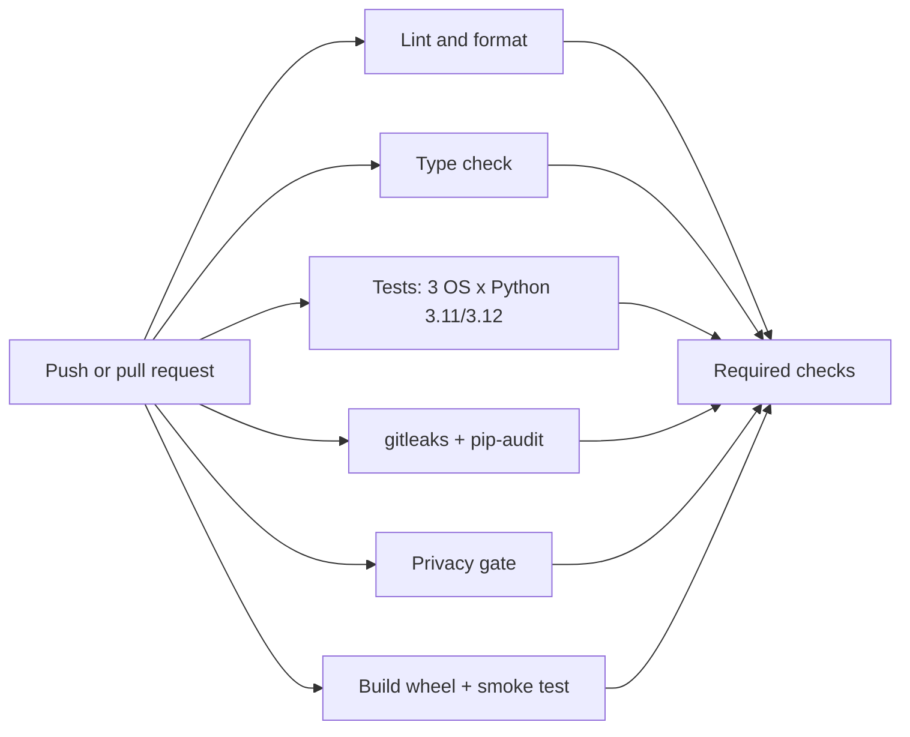

# 2. Tooling, Tests and CI

**Status:** Implemented in M0.2.
**Files:** [`pyproject.toml`](../pyproject.toml), [`uv.lock`](../uv.lock), [`.github/workflows/ci.yml`](../.github/workflows/ci.yml), [`tests/`](../tests/)

This guide connects the commands you type to the files that make them work.

## The repository layout

```
pyproject.toml        project metadata and tool configuration
.python-version       developer baseline: 3.12
uv.lock               exact resolved dependency versions
src/eis/              the importable package
tests/                pytest tests
policies/             declarative default policy
schemas/              JSON Schemas
scripts/              repository verification tools
docs/                 specifications and decisions
.github/workflows/    CI definitions
```

Runtime data — database, artifacts, logs, keys — does **not** live here. It belongs in the platform application-data directory. See [privacy](07-security-and-privacy.md).

## `pyproject.toml`

`pyproject.toml` is the single project definition.

```toml
[project]
name = "eis"
version = "0.1.0a0"
requires-python = ">=3.11,<3.13"
dependencies = ["fastapi>=0.115,<1", "pydantic>=2.10,<3", "typer>=0.15,<1"]

[project.optional-dependencies]
dev = ["pytest>=9.0.3,<10", "ruff>=0.9,<1", "mypy>=1.14,<2", ...]

[project.scripts]
eis = "eis.cli:app"
```

- **Runtime dependencies** are imported by the installed package.
- **Development dependencies** are installed with `--all-extras` and are not required by users.
- `requires-python` is the supported range: Python 3.11, 3.12. Python 3.13/3.14 are refused until tested.
- `[project.scripts]` creates the `eis` command.

Behind the scenes, Hatchling builds the package:

```toml
[build-system]
requires = ["hatchling>=1.27,<2"]
build-backend = "hatchling.build"

[tool.hatch.build.targets.wheel]
packages = ["src/eis"]

[tool.hatch.build.targets.wheel.force-include]
"policies" = "eis/_resources/policies"
"schemas" = "eis/_resources/schemas"
```

`force-include` puts the default policy and schemas inside the wheel, so an installed copy still works when the repository root is absent.

## uv

uv creates the environment, resolves dependencies and runs commands.

```powershell
uv sync --locked --all-extras
uv run pytest -q
uv run eis version
```

- `uv sync` creates `.venv` and installs the project.
- `--locked` refuses to change `uv.lock`; it guarantees you are testing the recorded versions.
- `uv run` executes a command inside the project environment.
- `uv.lock` is the reproducible dependency graph. Commit it; do not hand-edit it.

If `uv lock --check` fails, the lockfile and `pyproject.toml` disagree.

## Tests

pytest discovers files named `test_*.py` and functions named `test_*`.

```python
def test_unspecified_action_is_denied() -> None:
    policy = load_default_policy()
    request = PolicyRequest.from_mapping(
        {
            "principal": "agent:eis.primary",
            "action": "project.write",
            "resource": "project:unregistered",
        }
    )
    decision = PolicyEngine(policy).evaluate(request)
    assert decision.effect == "deny"
    assert decision.reason == "default_deny"
```

Common pytest tools in this repository:

| Tool | Use | EIS example |
|---|---|---|
| `tmp_path` | Temporary directory | Privacy guard detection tests |
| `monkeypatch` | Temporarily change environment variables | `EIS_DATA_DIR` override test |
| `CliRunner` | Invoke a Typer app | `eis policy-check` test |
| `TestClient` | Call FastAPI in-process | `/health` and `/api/v1/meta` tests |
| `pytest.raises` | Assert an exception | Malformed policy tests |

Test categories:

- `tests/test_repository_privacy.py` — repository boundary, ignored runtime data, untracked vision document.
- `tests/test_privacy.py` — synthetic leaks: paths, secrets, runtime files.
- `tests/test_policy_baseline.py` — deny-by-default behavior and schema validation.
- `tests/test_api.py` — OpenAPI generation and metadata endpoints.
- `tests/test_cli.py` — CLI contracts.
- `tests/test_import_contracts.py` — package/API/CLI entry points.
- `tests/test_storage.py` — SQLite migrations, consent/revocation/expiry and audit persistence.
- `tests/test_audit_chain.py` — hash chain, append-only triggers, tamper detection, integrity blocking and CLI verification.
- `tests/test_policy_persistence.py` — chained allow/deny decisions, provenance, audit failure, retries and redaction.
- `tests/test_approval_execution.py` — projection backfill/lifecycle, approval binding/expiry/state, path/root guards, profiles and CLI flows.
- `tests/test_runtime.py` — session/task migration, lifecycle, restart/resume, policy/consent denial, audit failure and privacy.
- `tests/test_project_tools.py` — strict tool schema, policy/audit gates, paths/secrets, size bounds, Git failures, explicit CLI and model-proposal non-dispatch.
- `tests/test_ci_pins.py` — every CI action has a full commit SHA.

Run one file while learning:

```powershell
uv run pytest tests/test_policy_baseline.py -q
```

## Linting and type checking

Ruff checks style and common bugs; Ruff Format keeps formatting consistent; Mypy checks type hints.

```powershell
uv run ruff check .
uv run ruff format --check .
uv run mypy src
```

Configuration lives in `pyproject.toml`:

- Ruff targets Python 3.11 (the lowest supported version).
- Mypy runs in strict mode on `src/`.
- Markdown files are excluded from Ruff formatting because they contain examples.

A passing test suite does not replace linting or typing. They catch different mistakes.

## CI

GitHub Actions runs the same checks on a clean machine. The workflow has separate jobs:



- **lint** — `ruff check`, `ruff format --check`.
- **typecheck** — `mypy src`.
- **test** — Ubuntu, Windows and macOS, Python 3.11 and 3.12.
- **security** — gitleaks for secrets in history, pip-audit for known dependency vulnerabilities.
- **privacy** — `eis privacy-check` plus the privacy tests.
- **package** — build wheel and sdist, verify bundled resources, install the wheel and run `eis version`.

Security note: every `uses:` action is pinned to a full 40-character commit SHA, not a moving tag. `tests/test_ci_pins.py` fails if a short tag is introduced. The pins were checked against upstream tags; CI itself has not run because no remote exists yet.

Windows note: `tests/conftest.py` selects `WindowsSelectorEventLoopPolicy` for the test session. Python 3.12's default Proactor loop can stall while creating its socket pair in restricted Windows sandboxes. The tests use mock transports and do not need Proactor-only features. This is a test-environment workaround, not a product change; the full suite also passed with normal Proactor enabled on the review workstation.

## Building a wheel

```powershell
uv build
uv run python scripts/verify_wheel.py
```

`uv build` creates `dist/eis-0.1.0a0-py3-none-any.whl` and a source archive. The wheel is the installable artifact; the source archive is for distribution and rebuilding.

`scripts/verify_wheel.py` checks that `eis/_resources/policies/default.json`, both schemas and the provider persistence migration are inside the wheel. This matters because a package that loses its policy file would fail at the first `policy-check`, and one that loses its migration would fail on first database use.

## What is implemented vs planned

| Area | Status |
|---|---|
| `pyproject.toml`, uv lock, Hatchling build | Implemented |
| Pytest suite, Ruff, Mypy | Implemented |
| CI jobs and SHA pins | Implemented, not yet executed on GitHub |
| Wheel resource verification | Implemented |
| Frontend build | Planned for M10 |
| Provider consent/audit migrations | Implemented |
| Full domain migrations and scanner binaries | Planned |

## Try it

```powershell
uv lock --check
uv sync --locked --all-extras
uv run pytest -q
uv run ruff check .
uv run mypy src
uv build
uv run python scripts/verify_wheel.py
```

Next: [APIs, FastAPI and CLI](03-apis-fastapi-cli.md).
