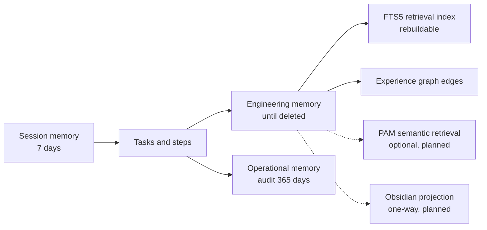

# 4. SQLite and the EIS Memory Model

**Status:** Provider consent/audit tables, chained and projected policy decisions, A3 approvals, execution runs, the Alembic migrations and the tamper-evident `audit_events` chain are implemented. Engineering-memory schema, retrieval and the full domain database remain specified.
**Specs:** [`docs/EIS_DATABASE_SCHEMA.md`](../docs/EIS_DATABASE_SCHEMA.md), [`docs/EIS_MEMORY_ARCHITECTURE.md`](../docs/EIS_MEMORY_ARCHITECTURE.md)

EIS is meant to remember engineering experience, not just conversations. That requires a database with explicit structure and provenance.

## Relational databases in one page

SQLite stores data in tables. A table has columns (fields) and rows (records).

```text
incidents
+------------+-------------+---------+-----------+
| id         | project_id  | state   | confidence|
+------------+-------------+---------+-----------+
| inc_01J... | prj_01J...  | verified| 82        |
+------------+-------------+---------+-----------+
```

- A **primary key** uniquely identifies a row (`id`).
- A **foreign key** points to a row in another table (`project_id` → `projects.id`).
- A **constraint** rejects invalid data, such as a confidence outside 0–100.
- An **index** speeds up a query at the cost of some write space.
- A **transaction** groups changes so they either all succeed or all fail.

SQLite is a file, not a server. It is a good fit for a local-first tool: no daemon, no network port, simple backup.

Planned settings from the schema document:

- WAL mode for better read/write concurrency;
- `foreign_keys=ON`;
- `busy_timeout` for short lock waits;
- `STRICT` tables where possible;
- one writer discipline, short transactions.

## Why SQLite and not a graph database

The cross-project experience graph is stored as typed **edges** in a normal table:

```text
edges(src_type, src_id, rel, dst_type, dst_id, provenance)
```

Example relationships:

- `project HAS_INCIDENT incident`
- `incident HAS_ROOT_CAUSE root_cause`
- `incident RESOLVED_BY solution`
- `solution VERIFIED_BY verification_run`
- `finding AFFECTS project`

Recursive SQL queries can follow a few hops. EIS does not need Neo4j or another graph server for a single-user local tool. If measurements ever justify a different store, that requires an ADR.

## The three memory layers

| Layer | Holds | Lifetime | Authority |
|---|---|---|---|
| Session memory | Current request, plan, temporary tool results | Session + 7 days | Working state only |
| Engineering memory | Projects, incidents, root causes, solutions, findings | Until user deletes | Authoritative EIS knowledge |
| Operational memory | Executions, approvals, jobs, audit | Audit 365 days by default | Authoritative record of what happened |

A fourth layer is derived: the **retrieval index** (SQLite FTS5, optional PAM semantic search). It is rebuildable and never the source of truth.



## Planned core tables

The full schema is large. These are the tables that explain the product:

| Table | Purpose |
|---|---|
| `projects` | Stable project identity, local path reference, Git identity |
| `project_snapshots` | Profile at a commit: languages, frameworks, evidence |
| `sessions`, `messages` | Conversation and task context |
| `tasks`, `task_steps`, `tool_calls` | What the agent planned and executed |
| `incidents` | Reusable failure record with state and confidence |
| `root_causes`, `solutions` | Analysis and candidate fixes |
| `verification_runs` | Evidence that a check actually ran |
| `security_findings` | Normalized scanner results |
| `approvals`, `policy_decisions` | Approvals planned; decisions currently stored as chain events |
| `skills`, `skill_versions` | Versioned procedures and metadata |
| `audit_events` | Append-only hash-chained history |
| `edges` | Cross-entity relationships |

The schema also has FTS5 virtual tables for incidents, solutions and findings.

## The incident: EIS's reusable unit

An incident is not a chat message. It records:

- project and commit;
- what failed, with a normalized error signature;
- environment and dependency versions;
- root cause;
- proposed and applied solution;
- affected components;
- verification evidence;
- applicability and limitations;
- provenance and timestamps.

The **error signature** is created by normalizing the error text: lowercase, remove UUIDs, hashes, timestamps, ports, absolute paths and addresses, but keep exception class, error code and failing symbol. This makes similar failures retrievable without embeddings.

## Knowledge states and confidence

| State | Meaning |
|---|---|
| `observed` | Retrieved from a source but not independently validated |
| `hypothesised` | An explanation awaiting verification |
| `verified` | Supported by matching evidence and a passing check |
| `superseded` | Replaced by newer knowledge |

A verified state requires a verification run whose project and commit match the claim. A fix verified in project A does **not** become verified in project B automatically.

EIS defines an **Evidence Confidence Score (ECS)**, a transparent 0–100 score:

```text
ECS = 100 * (0.45*V + 0.25*E + 0.20*A + 0.10*R)
```

- **V** — verification status
- **E** — evidence quality
- **A** — applicability to the target context
- **R** — recency

ECS is not a probability and is not generated by a model. It is a ranking and display aid with a stored component breakdown. The weights are a documented heuristic until research calibrates them.

## Source-of-truth boundaries

| Question | Source |
|---|---|
| What is the code at this commit? | The project's Git repository |
| What did EIS observe and conclude? | EIS SQLite |
| What evidence supports a claim? | Artifact store, referenced by hash |
| What is semantically similar? | PAM, optional and candidate-only |
| What should a human read? | Obsidian projection, marked generated |
| What did EIS execute? | Run ledger and audit chain |

The database never becomes the source of code, and Obsidian never becomes the database.

## Implemented vs planned

| Feature | Status |
|---|---|
| Provider consent/audit schema and Alembic migrations | Implemented |
| SQLite connection, WAL, foreign keys, busy timeout | Implemented |
| Append-only hash-chained `audit_events` and verifier | Implemented; tamper-evident only |
| External audit-anchor checkpoint interface | Implemented/tested with fake sink and an optional S3 Object Lock adapter tested with mocked AWS clients; operator `eis anchor create`/`verify` commands exist; no real bucket configured; local event is a receipt only |
| Chained policy decisions | Implemented through `PolicyService`; queryable projection in migration 0003 |
| A3 approvals and execution runs | Implemented; `execution_runs` successful rows are durable evidence for task/plan completion and execute retry recovery; broader approvals/actions planned |
| Cancellation + human-review state transitions | Migration `0009`; atomic `cancelled`, `blocked->running`, `human_review`, `skipped/failed cancelled`; successful `execution_runs` prevents cancellation |
| Sessions/tasks and lifecycle audit | Implemented in migration 0004; messages planned |
| Durable task plans and ordered steps | Implemented in migration 0006 (ADR-043); hashes, statuses and guarded transitions only |
| Read-only tool audit events | Implemented in hash chain; no separate tool-call projection |
| M2 repository walker | In-memory metadata-only scan; no schema migration; persisted labels/exclusions/scan timestamps/snapshots remain planned |
| Full domain schema, repositories, retention jobs | Planned for M1/M3 |
| FTS5 index and ranking | Planned for M3 |
| Incident reuse and adaptation | Planned for M3 |
| PAM adapter and Obsidian projection | Planned for M3 |
| Experience graph queries | Planned for M3/M5 |

## Try it

The provider consent/audit database can be inspected locally:

```powershell
uv run eis consent list
uv run eis audit verify
uv run eis policy-evaluate --principal user --action project.read --resource project:example
uv run eis policy-decisions
uv run eis approval list
uv run eis session create --title "Example" --project example
uv run eis session list
```

There is no incident/retrieval database to query yet. Read the entity map and the `incidents` table in [`docs/EIS_DATABASE_SCHEMA.md`](../docs/EIS_DATABASE_SCHEMA.md), then find the same fields in [`docs/EIS_MEMORY_ARCHITECTURE.md`](../docs/EIS_MEMORY_ARCHITECTURE.md). The repetition is intentional: the specification must agree with itself.

Next: [LLMs and the provider gateway](05-llms-and-ollama.md).
