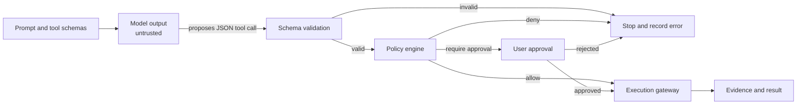

# 5. LLMs, Provider Gateway and Tool Calling

**Status:** Provider-neutral text gateway, vendor adapters, durable SQLite consent, content-free SQLite audit records and hash-chained decisions are implemented. There is no agent loop, model-directed tool execution or streaming; a narrow A3 write/fixed-profile execution gateway exists. Ollama is optional and is not the default.
**Specs:** [`docs/EIS_MODEL_PROVIDER_CONFIGURATION.md`](../docs/EIS_MODEL_PROVIDER_CONFIGURATION.md), [`docs/EIS_AGENT_RUNTIME_DESIGN.md`](../docs/EIS_AGENT_RUNTIME_DESIGN.md), [`docs/EIS_SECURITY_ARCHITECTURE.md`](../docs/EIS_SECURITY_ARCHITECTURE.md)

## What an LLM does

A large language model (LLM) predicts the next token given previous tokens. A **token** is a small chunk of text, roughly a word piece.

At inference time the model receives:

- a system prompt (rules and role);
- conversation or task context;
- tool descriptions;
- a request for the next output.

It returns text or a structured tool call. It does not run code, read files or browse the network by itself. Those actions require a surrounding program.

**EIS does not train, fine-tune or distil a model.** It uses existing models through a provider interface.

## Tokens, context and temperature

| Term | Plain meaning | Why it matters |
|---|---|---|
| Token | Piece of text | Billing, context limits, latency |
| Context window | Maximum tokens the model can see at once | Long files must be summarized or retrieved |
| Temperature | Randomness of sampling | Lower values are more repeatable; EIS defaults low |
| Prompt | Instructions and data sent to the model | Untrusted content must be clearly delimited |
| Completion | Model output | Treated as untrusted input by EIS |

A large context window is not a substitute for retrieval. Relevant evidence still has to be selected, ranked and cited.

## Supported providers

EIS has one typed provider contract and a registry with vendor-specific adapters:

| Provider | Protocol | Base URL |
|---|---|---|
| OpenCode | OpenAI-compatible Chat Completions | Required via `EIS_OPENCODE_BASE_URL` |
| OpenAI | Chat Completions | `https://api.openai.com/v1` |
| Gemini | `generateContent` | `https://generativelanguage.googleapis.com/v1beta` |
| Anthropic | Messages | `https://api.anthropic.com/v1` |
| xAI | Chat Completions (documented legacy) | `https://api.x.ai/v1` |

All endpoints, headers and shapes were checked against official documentation on 2026-11-20. Links and the full protocol table are in [`docs/EIS_MODEL_PROVIDER_CONFIGURATION.md`](../docs/EIS_MODEL_PROVIDER_CONFIGURATION.md).

Do not assume every provider uses the same JSON. OpenAI, xAI and OpenCode share Chat Completions; Gemini uses `contents`/`parts`; Anthropic uses content blocks and requires `max_tokens`.

## Configuration

Common selection:

| Variable | Purpose |
|---|---|
| `EIS_MODEL_PROVIDER` | `opencode`, `openai`, `gemini`, `anthropic`, `xai`, `ollama`, or unset |
| `EIS_MODEL` | Direct model ID; no default |
| `EIS_MODEL_TIMEOUT_SECONDS` | Optional timeout, 1–300 |
| `EIS_MODEL_CONSENT_CLASSES` | Explicit consent, e.g. `C0,C1`; absent means no call |
| `EIS_MODEL_CONSENT_PURPOSE` | Purpose label for the audit record |

Provider credentials:

| Provider | Variable(s) |
|---|---|
| OpenCode | `OPENCODE_API_KEY` or `EIS_OPENCODE_API_KEY` |
| OpenAI | `OPENAI_API_KEY` |
| Gemini | `GEMINI_API_KEY` or `GOOGLE_API_KEY` |
| Anthropic | `ANTHROPIC_API_KEY` |
| xAI | `XAI_API_KEY` |

Copy `.env.example` to a local `.env` and fill it there. Do not paste a real key into chat, source, tests, docs or the handoff file. The `eis` CLI loads `.env` from the current directory; tests disable that and use fake settings.

No provider is enabled by default. Ollama is optional and has no client in this slice.

## Consent and audit

External model calls fail closed unless an explicit, provider-scoped consent record covers the request's data class.

```dotenv
EIS_MODEL_CONSENT_CLASSES=C0,C1
```

- C0/C1/C2 can be listed; C3 is never allowed.
- No consent record means no network call.
- The gateway records an egress decision before the call.
- A successful or failed call produces a content-free model-call audit record: provider, model, request hash, timestamp, latency, status, usage, finish reason, provider request ID and consent reference.
- Request messages, response text and keys are never stored in the audit record.
- Consent and audit records are persisted in SQLite (`consents`, `egress_decisions`, `model_calls`).
- Consent is revocable and expires; a revoked or expired record is ignored on the next call.
- Every consent, egress and model-call write appends a content-free event to the hash-linked `audit_events` table in the same transaction.
- `uv run eis audit verify` recomputes the chain. It is tamper-evident, not tamper-proof, and has no external anchor yet.
- A JSONL audit sink remains available for diagnostics but is not chained.

```powershell
uv run eis consent grant --provider openai --classes C0,C1 --expires-days 30
uv run eis consent list
uv run eis consent revoke <consent-id>
uv run eis audit verify
```

## Provider contract

```python
class ModelProvider(Protocol):
    name: str
    @property
    def model(self) -> str: ...
    async def complete(self, request: CompletionRequest) -> CompletionResponse: ...
```

`ProviderRegistry` selects the adapter explicitly. Agent and policy code do not import vendor SDKs.

## Ollama is optional

Ollama is a local runtime that serves models over a loopback HTTP API. It can avoid sending prompts to a cloud provider, but EIS does not require it and does not enable it by default.

Current state:

- no provider is enabled by default;
- selecting `EIS_MODEL_PROVIDER=ollama` records the label but no Ollama client is implemented;
- selecting any external provider does not require Ollama;
- no model tag, context size or concurrency is assumed by the repository.

## Tool calling

Tool calling lets a model request an action in a structured form instead of writing free-form shell commands.



Today policy evaluation, the provider gateway, A3 project writes, fixed T1 profiles and four explicitly invoked read-only project tools exist. The tool path requires a strict typed call and a `PolicyService` allow; it is separate from model output. The model cannot execute or dispatch a tool call, and the agent-loop execution/approval steps are planned.

## What the model may and may not do

| The model may | The model may not |
|---|---|
| Suggest a plan | Grant itself a capability |
| Propose text or a tool call | Bypass the policy engine |
| Summarize evidence | Declare a fix verified without a run |
| Draft a patch | Apply a patch without approval |
| Ask for missing information | Read an unregistered path |
| Recommend a skill | Install or activate a skill |
| Explain uncertainty | Invent a confidence percentage |

Provider output is text. It has no capability and cannot turn a policy `deny` into an `allow`.

Current built-ins: `project.list`, bounded one-level `project.list_files`,
bounded UTF-8 `project.read_text`, and fixed `git.status`. Invoke explicitly
with `eis task invoke-tool`, or let the bounded runtime loop dispatch them when
a model response is a valid `tool_call` envelope; any other shape stops the run.
Audit records store hashes/status only, and the CLI does not print file contents.

## Prompt injection

Repository text is untrusted. A README, code comment, issue body or scanner output can contain instructions aimed at the model.

EIS's defence is architectural: content is labelled as data, the model has no authority, tools are schema-validated, paths resolve through registered roots, secrets never enter prompts, and injection attempts are recorded.

## Implemented vs planned

| Feature | Status |
|---|---|
| Five-provider registry and vendor adapters | Implemented |
| Text request/response normalization, usage, finish reason, request ID | Implemented |
| Explicit OpenCode base URL; fixed official bases for others | Implemented |
| Consent gate, no-call default, C3 rejection | Implemented |
| Egress and model-call audit records | Implemented |
| Local `.env` loading in CLI | Implemented |
| Mock-transport tests, no network or real key | Implemented |
| Streaming | Deferred |
| Tool calling and execution | Strict envelopes for bounded read-only tool calls and plans (ADR-042/043) |
| Images, audio, embeddings | Deferred |
| OpenAI/xAI Responses, Gemini Interactions, newer Anthropic versions | Not implemented |
| Ollama client | Not implemented |
| Persistent SQLite consent and audit records | Implemented |
| Hash-chained audit | Implemented; tamper-evident only, no external anchor |

## Try it

With no provider configured:

```powershell
uv run eis doctor          # model_provider=none, model_configured=false
uv run eis provider-check  # provider=none configured=false
```

After setting `.env` locally:

```powershell
uv run eis provider-check  # provider=openai configured=true ... api_key=set env_consent=C0,C1
```

`provider-check` validates settings only; it makes no network call. `uv run pytest tests/test_provider_adapters.py -q` uses mock transports.

Next: [Retrieval, evidence and provenance](06-retrieval-evidence-provenance.md).
