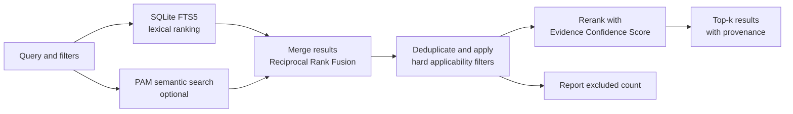

# 6. Retrieval, Evidence and Provenance

**Status:** Specified and planned. No retrieval code exists yet.
**Specs:** [`docs/EIS_MEMORY_ARCHITECTURE.md`](../docs/EIS_MEMORY_ARCHITECTURE.md), [`docs/EIS_RESEARCH_PLAN.md`](../docs/EIS_RESEARCH_PLAN.md)

## Why retrieval matters

The central EIS use case is cross-project reuse:

> A problem was solved in project A. A similar problem appears in project B. Find the earlier incident, compare context, and propose an adapted fix.

A model cannot remember every past project. Retrieval selects a small set of relevant records and presents them with evidence. The model can then reason over that context.

## Lexical retrieval

**Lexical** means matching words. SQLite's FTS5 extension builds an inverted index: for each word, it stores which rows contain it.

An FTS5 table might index an incident's title, symptom, error signature and limitations. A query like `foreign key constraint migration` returns rows containing those terms, ranked by relevance.

FTS5 benefits:

- works offline;
- explainable: you can see which terms matched;
- fast on local data;
- no embedding model required.

Limits:

- synonyms and paraphrases are missed;
- a query and a fix may share meaning but not words;
- word order and code identifiers need normalization.

## Semantic retrieval

**Semantic** retrieval maps text to vectors and finds nearby meanings. It handles paraphrases better but is harder to explain and can produce plausible but irrelevant neighbours.

EIS does **not** build its own vector database. It specifies an optional adapter to PAM, a separate personal memory project. PAM results are candidates, never facts.

## The planned pipeline

Stages:

1. **Normalize the query** — error signature, stack, version filters.
2. **Generate candidates** — FTS5 always; PAM when configured.
3. **Merge** — Reciprocal Rank Fusion: each result contributes `1 / (k + rank)`, with `k = 60` in the specification. This combines rankings without pretending the scores are comparable.
4. **Deduplicate** — same signature, same patch hash or near-duplicate title.
5. **Apply hard filters** — language, framework major version, project scope. Exclusions are counted, not silently dropped.
6. **Rerank** — combine text relevance with the Evidence Confidence Score.
7. **Return top-k** — default 10, maximum 50, each with source and evidence links.

## Evidence and provenance

**Provenance** answers: where did this claim come from?

Every important record links to:

- project ID;
- commit;
- file or artifact reference;
- tool or model source;
- execution ID;
- timestamp;
- verification outcome.

**Evidence** is the artifact itself: a test log, scanner output, patch, report or reproduction. An artifact is content-addressed by SHA-256, so a report can point to an exact file rather than a vague "we tested it."

A claim in an EIS answer should be one of:

| Kind | Requirement |
|---|---|
| Fact | At least one resolvable evidence reference |
| Hypothesis | Clearly labelled as unverified |
| Recommendation | Explains trade-offs and required verification |

A factual claim without evidence is a schema violation in the planned runtime.

## Reuse is not copying

Retrieval finds a precedent; it does not prove the precedent applies.

The planned adaptation check compares:

| Check | Question |
|---|---|
| Language/runtime | Same language and major runtime? |
| Framework | Same framework and compatible major version? |
| Dependencies | Are the implicated dependencies present and compatible? |
| Architecture | Is the failing component analogous? |
| Environment | OS, container, database, deployment differences? |
| Error signature | Same normalized signature or merely similar text? |
| Preconditions | Does the fix assume files, configs or permissions that are missing? |

The result is `applicable`, `partially_applicable`, `not_applicable` or `insufficient_evidence`. A partially applicable fix must be adapted and verified again.

## Worked example (synthetic)

Project A, `demo-api`, fails with a SQLite foreign-key error during a migration. The incident records:

- normalized signature `sqlite.foreignkey.constraint`;
- schema version and migration tool;
- root cause: a referenced table is created after the child table;
- solution: reorder the migration;
- verification: the migration test passes at commit `abc123`.

Project B, `demo-worker`, has a similar error but uses a different migration tool and an older SQLite version. Retrieval returns the Project A incident. The adaptation check marks it **partially applicable**: the table-order cause is plausible, but the migration tool differs, so the proposed fix must be translated and tested in B. The record does not inherit Project A's `verified` state.

## PAM boundary

- PAM is optional.
- EIS calls a versioned HTTP/JSON adapter, not PAM internals.
- Results are candidate-only.
- If PAM is unavailable, lexical retrieval still works.
- PAM receives a minimal query, not a repository dump.

## Implemented vs planned

| Feature | Status |
|---|---|
| Incident schema, error signature design | Specified |
| FTS5 index and ranking | Planned for M3 |
| RRF merge, deduplication, reranking | Planned for M3 |
| PAM adapter | Planned for M3 |
| Evidence artifacts and provenance | Planned for M1/M3 |
| Cross-project adaptation record | Planned for M3 |
| Retrieval evaluation (Recall@K, MRR, nDCG) | Planned for M12 |

## Try it

There is no index yet. To prepare, read the incident table in [`docs/EIS_DATABASE_SCHEMA.md`](../docs/EIS_DATABASE_SCHEMA.md) and the retrieval section of [`docs/EIS_MEMORY_ARCHITECTURE.md`](../docs/EIS_MEMORY_ARCHITECTURE.md). Ask yourself which fields would be needed to answer "is this the same failure?" without guessing.

Next: [Security and privacy](07-security-and-privacy.md).
