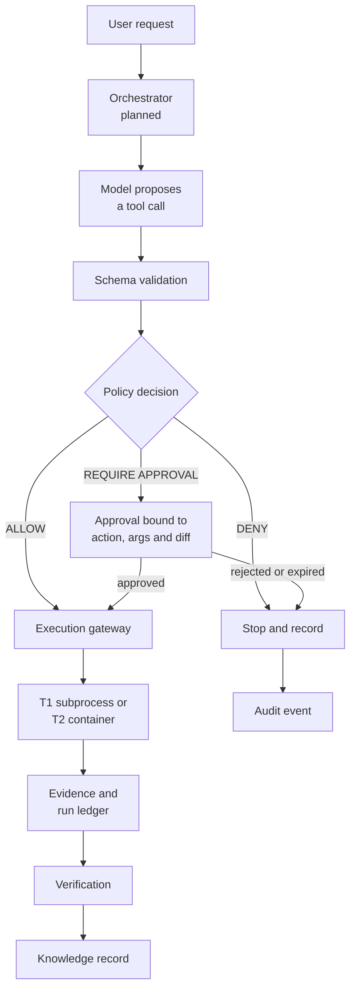
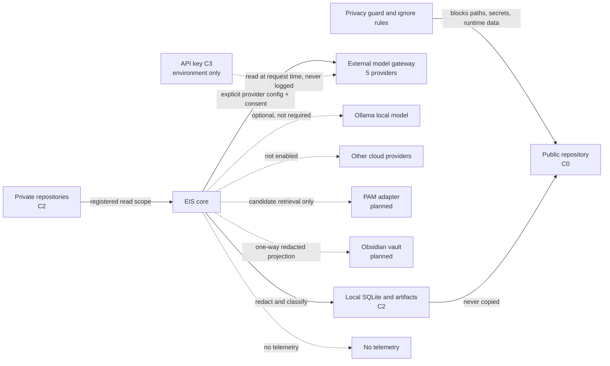

# 7. Security and Privacy

**Status:** The policy evaluator, provider consent/audit persistence, tamper-evident chain, digest-bound A3 writes, bounded T1, fail-closed Linux T2 backend, durable session/task and plan runtime, strict model envelopes, explicit read-only recovery, expanded pattern-based egress and structured-log redaction, and a task-bound plan-final write proposal requiring human approval are implemented. Model output never supplies identity, root, policy, image, mount or isolation fields. Delegation, broader capabilities, comprehensive secret detection and a real external audit-anchor deployment remain incomplete/unverified. The authenticated runtime API and human-review continuation are implemented; the external anchor interface is implemented and fake-backed tested, and an optional S3 Object Lock adapter plus operator-triggered `eis anchor create`/`verify` commands are tested with injected fake sinks and mocked AWS clients but have no configured/verified bucket. The authenticated API exposes no anchor create/verify route. A hosted Ubuntu job now exercises the real Linux T2 backend against a digest-pinned image and checked-in seccomp profile; T2 remains unavailable on Windows hosts and is not evidence against a compromised runner or kernel.
**Specs:** [`docs/EIS_SECURITY_ARCHITECTURE.md`](../docs/EIS_SECURITY_ARCHITECTURE.md), [`docs/EIS_THREAT_MODEL.md`](../docs/EIS_THREAT_MODEL.md), [`docs/EIS_EXECUTION_AND_PERMISSION_MODEL.md`](../docs/EIS_EXECUTION_AND_PERMISSION_MODEL.md)

## The core idea

EIS reads private code and can eventually run commands. It must not rely on the model to behave. Security controls are deterministic code outside the model.

The product principle is:

> Become more capable through verified experience, not more powerful through unrestricted permissions.

## Deny by default

A deny-by-default system allows an action only when an explicit rule says so. Missing, malformed or unknown input resolves to **deny**, never to allow.

Current policy file [`policies/default.json`](../policies/default.json):

```json
{
  "version": "2026.11-m0.2",
  "default": "deny",
  "rules": []
}
```

There are no allow rules yet. The evaluator in [`src/eis/policy.py`](../src/eis/policy.py):

- requires `default: "deny"`;
- rejects unknown fields;
- rejects wildcard grants;
- checks deny rules before allow rules;
- returns `default_deny` when nothing matches;
- fails closed on a malformed policy.

This is a **typed, schema-validated exact-match contract**. It validates canonical resource scopes, but it does not resolve them against registered roots. It is not the full M1 capability engine: broader approvals, obligations and general execution are still pending.

## Capabilities

A capability is a permission string over a typed resource. The planned model looks like:

```text
principal   agent:eis.debugging
action      project.write
resource    project:<id> + relative path + diff
decision    REQUIRE_APPROVAL
```

Planned examples:

- `project.read`
- `project.propose`
- `project.write` (user-delegated only)
- `project.verify`
- `knowledge.read`
- `skill.invoke`
- `net.egress`

Reserved capabilities such as `policy.write`, `approval.grant` and `secret.read` are never present in an agent or skill grant. Agents propose; the user authorises.

## Approvals

An approval is not a blanket "yes." It is bound to one action:

```text
digest = SHA-256(
  action, arguments, resources, diff hash,
  policy version, principal, expiry
)
```

If the diff changes, the arguments change or the approval expires, the approval is invalid. It is single-use.

| Class | Meaning | Example |
|---|---|---|
| A1 | Safe read | Read a file |
| A2 | Propose only | Generate a patch |
| A3 | Modify | Apply a patch or commit |
| A4 | Destructive/external | Delete, push, export private data |
| A5 | Security-relevant | Executable skill, new permission, policy change |

Approval does **not** replace sandboxing. A user can approve a risky action, but the action still runs with limits and isolation.

## Request, policy, approval and execution flow



The pure policy evaluator and audited `PolicyService` decision path exist. A3 project-write approvals and a narrow execution gateway exist; the agent loop, broader actions and T2 isolation are planned; M6 hardens isolation and recovery.

## Path boundaries

A project root is a directory the user explicitly registered. Relative paths inside that root are allowed; everything else is denied.

Implemented protections:

- roots are registered only by the explicit local-user CLI (`eis project register|list|remove`); the model and tool-call JSON never choose a root;
- registration rejects missing paths, files, filesystem roots, runtime data/config locations, duplicate or overlapping roots, and paths that resolve through a symlink or junction;
- the session project ID is resolved through `project_roots` on every invocation, and the registered path plus filesystem identity are re-checked;
- reject `..` traversal, absolute and drive-letter paths, known secret files/directories and non-regular files;
- normalise case on Windows;
- POSIX reads walk from a verified root descriptor with `O_NOFOLLOW`; Windows checks every component for links/reparse points and compares the opened handle identity, then re-checks the root after the read. A narrow Windows swap window remains because the standard library has no root-relative `openat`; it is documented, not claimed as solved;
- a moved, renamed or replaced root fails closed with a sanitized error code.

The M2 `eis project scan <id>` walker reuses the same root identity and safe-access primitives. It resolves only a registered project ID, lists metadata without reading file contents, skips symlinks/junctions, verifies the root before and after, and applies default plus per-invocation exclusions (`.git`, secret/cache/build names, `.env*`, binary/secret suffixes). Deterministic file-count, depth, total-byte and per-directory caps report an explicit incomplete reason; case-fold collisions are reported rather than merged. Results contain relative paths, sizes and counts only; no source content is persisted. A local 50k metadata scan met NFR-01, but it is not yet a hosted nightly benchmark. The documented Windows link/identity swap window and the per-directory cap remain residual limits.

The current privacy guard is a **repository** boundary, not a runtime file-access boundary. It scans tracked and untracked candidate files for private path patterns. The runtime path guard covers the four read-only tools described below plus the M2 metadata walker.

## Redaction

Secrets are classified **C3** and must never enter logs, artifacts, prompts or the database.

Planned pipeline:

1. **Detect** — pattern rules plus Gitleaks when available.
2. **Classify** — mark as C3.
3. **Redact** — replace with a typed placeholder.
4. **Store reference** — keep only the redacted form and detection metadata.
5. **Audit** — record the decision, never the value.

Redaction is best-effort. The planned design therefore blocks C3 from model context by classification, not merely filtering.

Current [`src/eis/privacy.py`](../src/eis/privacy.py) detects secret-shaped values in repository files. The runtime's [`src/eis/core/redaction.py`](../src/eis/core/redaction.py) applies narrow patterns for bearer/basic tokens, JWTs, PEM private-key blocks and headers, common API-key prefixes, environment-style assignments and credential-bearing URLs. `ModelGateway` applies it to the complete provider request immediately before transport; runtime goals, tool-call echoes, tool feedback and display previews are also redacted. Adapter errors never echo response bodies, and unexpected adapter failures become a fixed sanitized error with no cause chain. This is best-effort only: novel, encoded, split, truncated or unrecognized secrets and personal data may not match, and classification must still prevent known C3 content from entering context.

HTTP access logging uses [`src/eis/core/structured_logging.py`](../src/eis/core/structured_logging.py). It records only method, route path, status and a validated/generated correlation ID. It rejects credential-shaped field names and drops string values that change under redaction, so it never logs request bodies, provider output or recognized credentials. Correlation IDs help connect a request to an operational event; they do not authenticate a caller.

## Audit chain

An audit event answers: who did what, when, under which decision, and with what result.

Implemented properties:

- append-only through the application interface;
- database triggers reject update, delete, sequence gaps and broken previous-hash links;
- each event stores a stable ID, sequence, actor, event type, subject, decision, content-free payload, `prev_hash` and `hash`;
- `hash = SHA-256(prev_hash + canonical event JSON)`, starting from 64 zeroes;
- service-evaluated policy decisions, consent, egress/model calls, approval/execution transitions, project-root registration/removal and read-only tool outcomes append chain events;
- a tool decision and `tool_invocation_started` are persisted before the read; output/outcome audit includes hashes/status/byte count only;
- `eis audit verify` checks sequence continuity, canonical hashes and every previous-hash link;
- an integrity failure blocks further appends, provider calls and read-only tools; approval/execution checks remain as documented in the security architecture.

Not implemented as a scheduled job: a daily external anchor and startup integrity check. An optional S3 Object Lock adapter and explicit `eis anchor create`/`verify` commands exist and are tested with mocked clients, but no real bucket is configured or verified and nothing runs automatically. Without a real external anchor, truncating the tail of the chain is undetectable. This is **tamper-evident, not tamper-proof**. A privileged actor can rewrite the local chain after dropping triggers; a provisioned anchor and alert would make that detectable. The threat model states this limitation.

## Read-only project tools

The current registry contains only `project.list`, `project.list_files`,
`project.read_text` and `git.status`. Calls are explicit (`eis task invoke-tool`)
and use a strict schema with no extra fields or duplicate JSON keys. The
runtime-injected principal is evaluated by `PolicyService` before tool work;
neither the request nor model output can choose a principal.

Paths are relative to the registered root selected by the session's project ID.
Absolute paths, traversal, known secret files/directories, symlink/junction
components and non-regular files are rejected. The registry is durable and
re-checked per access; a missing, moved or replaced root is denied. POSIX uses a
descriptor walk with `O_NOFOLLOW`; Windows uses component checks plus
opened-handle identity comparison, leaving a documented residual swap window.
Listings scan at most 5000 entries and return at most 100; text reads are capped
at 32 KiB; Git status is a fixed no-shell command with a 5-second timeout and
64 KiB output limit. Git results are reduced to branch and status counts. Tool
and root audit stores hashes/status/byte counts/error codes only, and the
default CLI never prints file contents or absolute root paths. No writes,
arbitrary commands, network tools or provider-native tool calls are connected.

## Isolation tiers

| Tier | Mechanism | Use |
|---|---|---|
| T0 | In-process pure function, no I/O | Parsing, scoring, formatting |
| T1 | Subprocess with cwd jail, env scrub, timeout, output cap, no shell | Trusted scanners and project tests |
| T2 | Container, non-root, read-only mounts, no network, CPU/memory/PID limits | Untrusted code and executable skills |

**Windows T1 is not a security boundary.** A subprocess runs with the user's rights. For untrusted execution EIS requires T2 or refuses the operation. The current configuration records `untrusted_execution=require_t2_or_refuse`; no sandbox exists yet.

## Privacy and data flow

Data classes:

| Class | Meaning | Example |
|---|---|---|
| C0 | Public | Source code, docs, synthetic fixtures |
| C1 | Internal | Audit metadata, job status |
| C2 | Confidential | Private source, incidents, findings |
| C3 | Secret | Tokens, keys, passwords |



Rules:

- Runtime data lives outside the repository.
- No provider is enabled by default. External providers require explicit environment configuration and consent.
- Provider API keys are C3, read from the environment, and never written to config, logs, errors or API responses.
- Ollama is optional, not the default.
- PAM is optional and candidate-only.
- Obsidian is a derived projection, never authoritative.
- Telemetry is not implemented.
- The privacy guard is one layer, not the only boundary.

## Current behavior

```powershell
uv run eis policy-check     # proves an unlisted action is denied
uv run eis privacy-check    # scans repository candidates
uv run eis doctor           # checks runtime path, roots, provider and retention defaults
uv run eis provider-check   # validates provider settings without a network call
```

What exists:

- typed, schema-validated exact-match deny-by-default policy;
- explicit deny precedence and deterministic policy/input hashes;
- policy and decision JSON Schemas;
- decision audit record and sink contract;
- five-provider registry and vendor-specific text adapters;
- provider-scoped consent gate with durable SQLite records and revoke/expiry;
- content-free SQLite egress/model-call audit records;
- append-only hash-chained audit events over policy decisions, consent, egress, model calls, approvals and executions;
- digest-bound, expiring, single-use A3 approvals for `project.write`;
- guarded project writes with root/path checks, backup and atomic replacement;
- fixed-profile T1 execution for trusted projects, with timeout and output caps;
- durable session/task lifecycle with content-free audit events and an untrusted human-review stop;
- explicit, bounded recovery of interrupted read-only plan steps after policy/root rechecks; no automatic startup resume;
- expanded best-effort credential redaction at the provider gateway and in structured logs, with documented limits, and structured API request logs with correlation IDs;
- environment-only API key handling with masked representations;
- no provider enabled by default; Ollama optional;
- repository privacy guard;
- platform runtime paths outside the repository;
- tests for policy, policy persistence, privacy, provider adapters, consent/audit, audit chain, repository boundary, digest-bound approval/execution routes and retry recovery (`tests/test_api_approvals.py`, `tests/test_task_approval_loop.py`).

What remains incomplete:

- full capability registry and decision obligations;
- generalized resource resolution and complete C3 classification/redaction coverage;
- real external audit-anchor deployment and startup integrity check;
- full plan/act session/task loop beyond the bounded read-only and task-bound write-approval slices (delegation and human-review continuation);
- model-directed tool execution beyond the four registered read-only tools;
- T2 on Windows or where the probe cannot demonstrate Linux-container protections; T1 profiles are restricted to application-registered commands and trusted projects, and T1 is not a Windows security boundary;
- approvals for operations beyond A3 project-file writes, including Git, delete and network actions.
- authenticated API actions beyond session/task and approval/audit read routes (approval decisions, execution, roots, bootstrap, SSE and cancellation); health and metadata remain public.

The current A3 write flow stores the exact diff/content locally, binds approval to its digest and file hashes, requires explicit grant, rechecks policy and chain integrity, backs up existing bytes, then atomically replaces the file. Review a proposal with `eis approval show <id>` before granting it. `eis policy-decisions` reads the content-free projection; the chained event remains the integrity source.

## Try it

```powershell
uv run eis policy-check
uv run eis policy-decisions
uv run eis audit verify
uv run eis approval --help
uv run pytest tests/test_approval_execution.py tests/test_policy_baseline.py tests/test_privacy.py -q
```

Then read [`docs/EIS_THREAT_MODEL.md`](../docs/EIS_THREAT_MODEL.md) and identify one attack path that the current code cannot stop. That gap is why M1 and M6 exist.

Next: [Agent runtime and skills](08-agent-runtime-and-skills.md).
