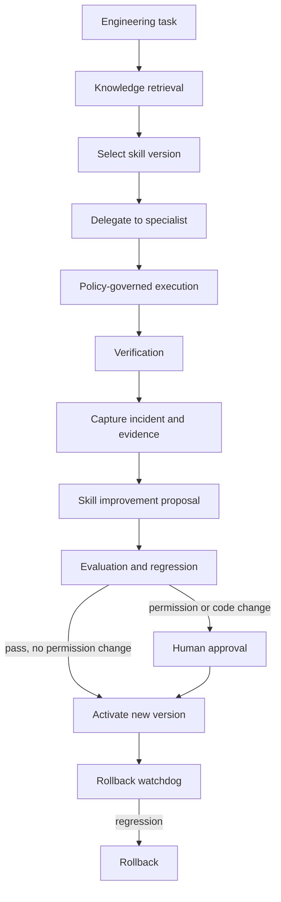

# 8. Agent Runtime, Specialists and Skills

**Status:** A durable session/task runtime exists with a bounded model loop: up to 3 policy-gated completions and 2 read-only tool calls per run, driven by a strict JSON envelope (ADR-042). Every response is validated before dispatch, identity/root/policy fields from the model are rejected, and successful answers stop for human review. Full plan/act/observe loop (plans, delegation, approvals, recovery), specialist execution and skill loader remain specified and planned.
**Specs:** [`docs/EIS_AGENT_ARCHITECTURE.md`](../docs/EIS_AGENT_ARCHITECTURE.md), [`docs/EIS_AGENT_RUNTIME_DESIGN.md`](../docs/EIS_AGENT_RUNTIME_DESIGN.md), [`docs/EIS_SKILL_SYSTEM.md`](../docs/EIS_SKILL_SYSTEM.md), [`docs/EIS_SKILL_EVOLUTION.md`](../docs/EIS_SKILL_EVOLUTION.md)

## What an agent is here

An agent is a loop around a model:

1. understand the goal;
2. assemble context;
3. ask the model for a typed action (plan, tool call, delegation or final answer);
4. validate the action;
5. pass it through policy and execution;
6. record evidence;
7. repeat or stop.

The model is not the agent. The runtime owns state, limits, tool routing and evidence.

EIS plans a **hybrid multi-agent** design: one primary agent plus six specialist roles in the same runtime. They are roles, not separate services. They share the policy engine, execution gateway and evidence ledger.

## Planned task states

```text
created -> planned -> awaiting_approval -> running -> verifying -> completed
   |          |              |               |          |
   |          |              |               |          +-> failed
   |          |              |               +------------> cancelled
   |          |              +----------------------------> rejected
   |          +-------------------------------------------> blocked
   +------------------------------------------------------> failed
```

A task is persisted before side effects. A crash should leave a resumable record, not a lost conversation.

## The six specialist roles

| Role | Focus | Typical output |
|---|---|---|
| Primary | Understand, plan, delegate, synthesise, request approval | Plan, answer, approval request |
| Debugging | Failure investigation and root cause | Hypotheses, proposed patch, verification plan |
| Security | Scanner coordination, triage, remediation | Findings, risk assessment, coverage statement |
| Testing | Test selection, execution, regression analysis | Run summary, failure clusters |
| Architecture | Components, dependencies, contracts, impact | Component map, impact report, ADR draft |
| Release | Readiness gates and release evidence | Readiness report, unresolved risks |
| Knowledge | Capture, link, extract patterns, propose skill changes | Incident record, reuse assessment |

The primary role coordinates. A specialist receives a bounded task and cannot expand its capabilities or bypass the gateway.

## Delegation

A delegation is a structured record, not a free-form chat:

```json
{
  "role": "eis.debugging",
  "objective": "Determine why the migration fails",
  "project_scope": ["prj_..."],
  "constraints": {"read_only": true, "max_steps": 15},
  "expected_output_schema": "delegation.debugging.v1"
}
```

The child task gets the intersection of the parent's capabilities and the role ceiling. It can return `blocked` if it needs something it does not have. Delegation depth is capped at one in v1 to bound cost and complexity.

Outputs distinguish:

- **fact** — supported by a resolvable evidence reference;
- **hypothesis** — plausible, not yet verified;
- **recommendation** — a proposed action with trade-offs.

A fact without evidence is rejected by the planned schema.

## What a skill is

A skill is a reusable procedure, not a tool. Tools perform side effects; skills describe how to reason and which tools to request.

Planned package:

```text
skill-name/
  SKILL.md          # Agent Skills-compatible instructions
  manifest.yaml     # EIS identity, risk, provenance, evaluation
  permissions.yaml  # declared capabilities and limits
  tests/            # structural and safety checks
  evaluations/      # behavioural cases
  changelog.md      # version history
  scripts/          # optional executable content
```

`SKILL.md` uses the Agent Skills format (`name`, `description`, optional `license`, `compatibility`, `metadata`, `allowed-tools`). EIS-specific data stays in the manifest, not in non-standard frontmatter.

## Trust classes

| Class | Source | Default |
|---|---|---|
| Built-in | Shipped with EIS | Enabled |
| Verified | Curated, signed | Enabled after approval |
| Private | User-authored | Enabled after validation |
| Community | Public contribution | Disabled; declarative only unless elevated |
| Experimental | Author-flagged | Disabled; T2 only |

A community skill is untrusted. Installation must not execute package code. Validation includes archive safety, schema checks, secret and URL scans, permission analysis, static analysis, behavioural evaluation in T2 and human review for elevated risk.

## Controlled evolution

EIS may improve a skill **within its existing permission boundary**. It may not grant itself new tools, network access, dependencies or executable code.

| Change class | Example | Activation |
|---|---|---|
| E0 | Clarify wording or examples | Automatic if evaluation is non-inferior |
| E1 | Better retrieval hints or trigger description | Automatic if evaluation is non-inferior |
| E2 | Use an already-granted read-only tool in a new step | Approval by default; auto only with explicit opt-in |
| E3 | New capability, dependency or network use | Human approval |
| E4 | Add or change executable code | Human approval + T2 |
| E5 | Policy or security change | Human approval + ADR |

The planned loop:



Automatic activation requires:

- enough executions and samples;
- a non-inferiority check with confidence intervals, not a single run;
- 100% critical-case pass;
- no permission diff;
- a rollback reference.

Any critical failure triggers rollback. The previous version stays immutable and resolvable.

## Why this is not "self-modifying code"

The skill's instructions may improve. The authority boundary does not. A candidate cannot:

- add a capability or tool;
- add a dependency;
- add network access;
- edit the evaluation suite to remove failures;
- change its own thresholds;
- modify another skill.

Those changes become ordinary reviewed changes, not automatic evolution.

## Implemented vs planned

| Feature | Status |
|---|---|
| Session/task persistence and recovery | Minimal durable sessions/tasks and plans implemented; full recovery planned |
| Durable task plans (ADR-043) | Up to six dependency-gated read-only steps, guarded transitions, content-free audit; `eis plan run/show/steps`; no delegation or blocked-plan resume |
| Read-only project tools | Explicit `task invoke-tool` calls and the bounded model loop (ADR-042: strict envelope, ≤3 completions, ≤2 tool calls, repeated-call stop); durable root registry, strict schema, policy decision, audited start/outcome |
| Agent roles, task states, delegation protocol | Specified |
| Specialist agents | Planned for M5 |
| Skill format, validation, registry | Planned for M4 |
| Skill execution and metrics | Planned for M4 |
| Skill evolution, evaluation, rollback | Planned for M8 |
| Approval gate and execution gateway | A3 writes and fixed T1 profiles implemented; broader gate/T2 planned |
| T2 verification backend (ADR-044) | Fail-closed Linux-container backend for registered profiles/untrusted projects; unavailable on Windows; no model-supplied executable, image, mount or flags |
| Approval API routes (ADR-046) | `POST /api/v1/approvals/{id}/decision|execute` bearer-authenticated, digest-bound, policy/root/content rechecked; execute retry recovers from `execution_runs` without repeating writes; `tests/test_api_approvals.py` |
| Cancellation + human-review continuation (ADR-047) | `eis task cancel`, `eis plan continue-review`; `POST /api/v1/tasks/{id}/cancel`, `POST /api/v1/tasks/{id}/review/continue`; `task.cancel`/`task.run`, atomic events, successful execution wins, no permission grant; `tests/test_task_cancellation_review.py` |

There is no full plan/act agent loop to run today. The runtime runs a bounded read-only loop — at most three completions and two tool calls per run — or a bounded plan of at most six dependency-ordered read-only steps; both stop for human review or with a content-free failure code. Plans store only hashes and statuses, and their text is shown only with `--show-proposal`. Delegation, broader approvals, blocked-plan recovery, T2, external anchoring and a CLI policy evaluator remain manual or planned.

## Try it

Read the task state machine and delegation envelope in [`docs/EIS_AGENT_ARCHITECTURE.md`](../docs/EIS_AGENT_ARCHITECTURE.md). Then read the skill package example in [`docs/EIS_SKILL_SYSTEM.md`](../docs/EIS_SKILL_SYSTEM.md). Ask: which fields would a reviewer need to decide whether a skill is safe?

Next: [Architecture map](09-architecture-map.md).
