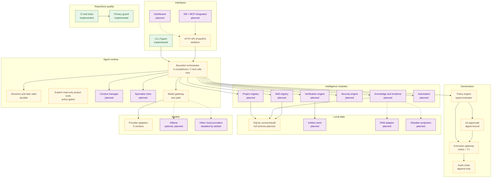

# 9. EIS Architecture Map

**Status:** Mixed. The diagram labels implemented M0.2 pieces and planned M1+ pieces.
**Specs:** [`docs/EIS_SYSTEM_ARCHITECTURE.md`](../docs/EIS_SYSTEM_ARCHITECTURE.md), [`docs/EIS_ARCHITECTURE_DECISIONS.md`](../docs/EIS_ARCHITECTURE_DECISIONS.md), [`docs/M0.2_DECISIONS.md`](../docs/M0.2_DECISIONS.md)

## Big picture



Green = implemented; amber = minimal/skeleton; purple = specified, not implemented.

## Layers

| Layer | Responsibility | Current state |
|---|---|---|
| Interfaces | CLI, API, dashboard, IDE/MCP | CLI and metadata API exist |
| Agent runtime | Plan, context, model calls, explicit read-only tools, delegation, recovery | Durable session/task with a bounded strict-envelope model loop (≤3 completions, ≤2 read-only tool calls) and explicit `task invoke-tool`; plans, delegation and recovery planned |
| Governance | Policy, approvals, execution gateway, audit | Policy, A3 approvals, bounded writes/profiles and audit exist; broader execution planned |
| Intelligence modules | Projects, knowledge, skills, security, verification, automation | Specified |
| Local data | SQLite consent/audit/approvals/execution/sessions/tasks implemented; artifacts, PAM, Obsidian and full schema planned | Partial |
| Models | Provider gateway/adapters and the bounded-loop runtime implemented; full plan/act orchestration and optional Ollama planned | Text gateway + bounded runtime only |
| Repository quality | Tests, CI, privacy guard | Implemented |

## Processes

The design uses a modular monolith, not microservices:

| Process | Command | Responsibility |
|---|---|---|
| API | `eis serve` (planned) | HTTP, SSE, short interactive work |
| Worker | `eis worker` (planned) | Durable jobs, scans, verification |
| CLI | `eis <command>` | In-process application services |
| Frontend | static build (planned) | Dashboard only |

The CLI does not need the API to be running. Both should call the same application services, so policy and evidence cannot diverge.

## Where the code lives

```text
src/eis/
  api.py          FastAPI application factory
  cli.py          Typer commands
  config.py       runtime paths and safe defaults
  core/           policy service and audit-chain contracts
  storage/        SQLite consent, audit chain and policy-decision sink
  policy.py       deny-by-default policy contract
  privacy.py      repository privacy guard
tests/            pytest baseline
policies/         default policy
schemas/          JSON Schemas
docs/             specifications and ADRs
```

Planned modules such as `core/agent_runtime` and `modules/project_registry` do not exist yet. `adapters/models`, SQLite consent/audit storage, the policy engine, `PolicyService` and the audit chain do exist. The target layout is in [`docs/EIS_TECHNICAL_DESIGN.md`](../docs/EIS_TECHNICAL_DESIGN.md).

## Trust boundaries

| Boundary | Inside | Outside | Control |
|---|---|---|---|
| Host | EIS processes | Network peers | Loopback bind and token (planned) |
| Repository | Registered roots | Everything else | Durable root registry, canonical path/identity checks, no-follow access |
| Model | EIS core | Provider and model output | Egress policy, untrusted output |
| Content | EIS instructions | Repo text, tool output | Delimited as data |
| Skill | Validated skill | Community package | Validation and T2 (planned) |
| Tool | Trusted adapter | External binary/MCP | Allowlist and sandbox (planned) |
| Evidence | Append-only ledger | Mutable workspace | Audit chain implemented; external anchor planned |

Repository text never becomes an instruction. The policy engine is the only authority.

## How to trace a feature

Example: "a user asks EIS to fix a failing migration."

1. The CLI or API creates a request — planned M1.
2. The orchestrator opens a task and retrieves prior incidents — planned M1/M3.
3. The model proposes a plan; `PolicyService` decides and chains the decision — evaluation/chaining implemented, agent wiring planned M1.
4. A write requires A3 approval bound to the exact diff and digest — implemented for `project.write`.
5. The gateway applies the patch and runs fixed profiles — implemented narrowly; broader execution/sandboxing planned.
6. Verification produces evidence; knowledge capture proposes an incident — planned M3/M7.
7. A skill improvement may be evaluated and rolled back — planned M8.

Today, metadata reads, static policy evaluation, chained decisions, bounded model envelopes, durable plans, A3 writes and fixed-profile verification exist. There is no delegation or broad resource resolver.

## Reading order for the specs

1. [Product specification](../docs/EIS_PRODUCT_SPEC.md) — what and why.
2. [System architecture](../docs/EIS_SYSTEM_ARCHITECTURE.md) — components and data flows.
3. [Technical design](../docs/EIS_TECHNICAL_DESIGN.md) — stack and repository layout.
4. [Execution and permission model](../docs/EIS_EXECUTION_AND_PERMISSION_MODEL.md) — authority.
5. [Memory architecture](../docs/EIS_MEMORY_ARCHITECTURE.md) — knowledge and retrieval.
6. [Agent runtime](../docs/EIS_AGENT_RUNTIME_DESIGN.md) — loop and limits.
7. [Skill system](../docs/EIS_SKILL_SYSTEM.md) and [evolution](../docs/EIS_SKILL_EVOLUTION.md).
8. [Threat model](../docs/EIS_THREAT_MODEL.md) and [privacy](../docs/EIS_PRIVACY_AND_DATA_GOVERNANCE.md).
9. [Roadmap](../docs/EIS_IMPLEMENTATION_ROADMAP.md) — when each piece is planned.

## Implemented vs planned

| Area | Status |
|---|---|
| CLI, API metadata, policy evaluator, privacy guard, config | Implemented |
| JSON Schemas, CI, tests, wheel packaging | Implemented |
| Agent runtime, sessions/tasks, model calls and bounded read-only plans | Minimal runtime implemented; full loop/delegation planned M1+ |
| SQLite consent/audit, policy, provider gateway, approvals, bounded execution | Implemented |
| Incidents, retrieval, full SQLite schema | Planned M1/M3 |
| A3 approvals and bounded T1/T2 gateway exist; broader approvals and Windows T2 | Partial/planned M1/M6 |
| Skills, specialists, evolution | Planned M4/M5/M8 |
| Dashboard, IDE/MCP, automation | Planned M9/M10 |

Next: [Glossary](10-glossary.md).
