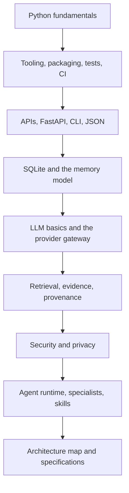

# Learning EIS

This folder is a beginner-friendly path through the skills you need to read, run and eventually extend the Engineering Intelligence System (EIS). It is not API documentation and it is not a promise that every described feature exists.

EIS is currently at the M0.2 foundation plus M1 policy, provider, storage, audit, approvals, bounded execution, durable sessions/tasks, registered project tools, strict model envelopes, durable plans, explicit read-only recovery, task-bound write proposals with human approval, and a fail-closed Linux T2 backend. Delegation, approval decisions/execution and broader authenticated API resources, human-review continuation, broad resource resolution, external audit anchoring, and proven T2 operation on a Linux host remain incomplete. Every guide marks the difference.

## How to use this folder

1. Read this page and the [glossary](10-glossary.md).
2. Follow the roadmap below in order. Each guide is short and links to the next one.
3. Run the commands in the "Try it" sections. They work against the current M1 slices.
4. When a guide says **planned**, treat it as a design contract, not working software.
5. Read the linked specification only after the concept guide; the specs are denser and assume the vocabulary.

## Status labels

| Label | Meaning |
|---|---|
| **Implemented** | Code exists in this repository and has tests or a CLI command |
| **Skeleton** | A small, real piece exists, but the full feature does not |
| **Specified / planned** | Decisions and acceptance criteria exist in `docs/`; code is not written |
| **Concept** | General background needed to understand EIS |

## Learning roadmap



## Guides

| # | Guide | What you learn | Implementation status |
|---|---|---|---|
| 1 | [Python fundamentals](01-python-fundamentals.md) | Variables, types, control flow, functions, modules, exceptions, type hints | Implemented examples in `src/eis/` |
| 2 | [Tooling, tests and CI](02-tooling-tests-ci.md) | `pyproject.toml`, uv, hatchling, pytest, Ruff, Mypy, GitHub Actions | Implemented |
| 3 | [APIs, FastAPI and CLI](03-apis-fastapi-cli.md) | HTTP, JSON, FastAPI, Pydantic, Typer, schemas, configuration | API and CLI skeleton implemented |
| 4 | [SQLite and the memory model](04-sqlite-and-memory.md) | Tables, keys, transactions, WAL, FTS5, session/engineering/operational memory | Memory model specified; provider consent/audit tables implemented |
| 5 | [LLMs and the provider gateway](05-llms-and-ollama.md) | Inference, tokens, five provider protocols, durable consent/audit, tool-call authority | Gateway/consent/audit implemented; bounded plans, explicit recovery, task-bound human-approved writes and human-review continuation implemented; delegation planned |
| 6 | [Retrieval, evidence and provenance](06-retrieval-evidence-provenance.md) | FTS5, ranking, fusion, evidence links, adaptation | Specified, not implemented |
| 7 | [Security and privacy](07-security-and-privacy.md) | Deny-by-default, capabilities, approvals, path boundaries, redaction, audit, T1/T2 | Task-bound write approval path and explicit read-only recovery implemented; delegation, broader approvals and external anchoring pending |
| 8 | [Agent runtime and skills](08-agent-runtime-and-skills.md) | Turn loop, specialist roles, delegation, skill packages, controlled evolution | Specified, not implemented |
| 9 | [Architecture map](09-architecture-map.md) | Components, processes, trust boundaries, where code lives | Mixed; labelled |
| 10 | [Glossary](10-glossary.md) | Plain-language definitions of EIS terms | Reference |

## What works today

These commands are real and runnable from the repository root:

```powershell
uv sync --locked --all-extras
uv run eis version
uv run eis doctor
uv run eis provider-check
uv run eis policy-check
uv run eis privacy-check
uv run pytest -q
uv run ruff check .
uv run mypy src
```

Current behavior:

- **CLI** with `version`, `doctor`, `provider-check`, `policy-check`, `policy-evaluate`, `policy-decisions`, `consent`, `audit`, `approval`, `project`, `session`, `task`, `task invoke-tool` and `privacy-check`.
- **HTTP API factory** exposing `GET /health` and `GET /api/v1/meta`; no authentication or runtime endpoints yet.
- **Typed, deny-by-default policy engine** with schema-validated exact-match rules, explicit-deny precedence, deterministic decision IDs, a decision audit-record/sink contract and a service boundary that chains decisions before returning.
- **Provider-neutral text gateway** with OpenCode, OpenAI, Gemini, Anthropic and xAI adapters; durable SQLite consent, content-free egress/model-call audit, environment-only keys and no provider by default.
- **Tamper-evident audit chain** over policy decisions, consent, egress, model-call, approval, execution and session/task lifecycle events, with an append-only SQLite table, verifier and `eis audit verify`. It is tamper-evident, not tamper-proof.
- **Minimal durable session/task runtime** with `session`/`task` CLI, one policy-gated `task.run` decision and a bounded model loop (at most 3 completions and 2 tool calls per run), ending in an untrusted human-review proposal or a content-free failure code.
- **Read-only project tools**: durable explicit project-root registration, registered project listing, bounded file listing/text reads, and fixed Git status. Strict explicit `task invoke-tool` calls and the model loop resolve the session project through the registry and go through policy and the audit chain; model responses are accepted only as a strict JSON envelope that rejects identity, root and policy fields.
- **Digest-bound A3 approvals and bounded execution** for project-file writes and fixed T1 verification profiles; private diffs stay local, T2 and untrusted profiles are refused.
- **Privacy guard** for absolute path patterns, runtime data files and secret-shaped values.
- **Configuration defaults** with no project roots, no provider enabled, optional Ollama, and runtime data outside the repository.
- **JSON Schemas** for policy and policy decisions.
- **CI definition and 189 tests**.

## What is specified but not implemented

Do not assume these work:

- Full model-driven plan/act loop beyond bounded plans, read-only recovery and task-bound human-approved writes; delegation, human-review continuation and broad step/limit recovery remain open.
- Full SQLite domain schema (incidents, findings, run ledger), external audit anchoring, backup and retention automation.
- Agent-loop delegation, human-review continuation and streaming orchestration.
- OpenAI/xAI Responses, Gemini Interactions, newer Anthropic versions and the Ollama client.
- Retrieval over incidents, FTS5 queries, PAM adapter.
- Execution gateway beyond the narrow project-write/fixed-profile slice, broader approvals, broad path guard and T2 outside a probed Linux container host.
- Skill installation, validation, execution and evolution.
- Specialist agents, dashboard, scanners, verification adapters, automation.

## What this learning set deliberately leaves out

These topics are **not** covered because EIS does not implement them and the specifications do not define them as current scope:

- Training, fine-tuning or evaluating a machine-learning model. EIS uses models; it does not train them.
- Vector-database internals. EIS plans to use PAM as an optional retrieval adapter, not to build its own vector store.
- Kubernetes, cloud infrastructure or multi-tenant deployment.
- Team accounts and role-based access control. v1 is single-user.
- PAM internal architecture. PAM is a separate project reached through an adapter.
- Obsidian vault setup and note design beyond the one-way projection contract.
- Dashboard implementation details. The frontend is planned for M10.
- Scanner-specific rule writing. EIS plans to orchestrate scanners, not replace them.

## Verify, don't assume

The repository is the source of truth:

- Current code: [`src/eis/`](../src/eis/)
- Current tests: [`tests/`](../tests/)
- Policy decision model: [policy engine](../docs/EIS_POLICY_ENGINE.md)
- Bootstrap evidence: [M0.2 decisions](../docs/M0.2_DECISIONS.md)
- Full architecture: [system architecture](../docs/EIS_SYSTEM_ARCHITECTURE.md)
- Security contract: [security architecture](../docs/EIS_SECURITY_ARCHITECTURE.md)

If a guide and the code disagree, the code wins. If a guide and an accepted ADR disagree, the ADR wins.

## Coordination

Codex and OpenCode use [CODEX_OPENCODE_HANDOFF.md](CODEX_OPENCODE_HANDOFF.md) for dated notes. It is temporary and will be deleted when the project is finished; do not delete it now.
